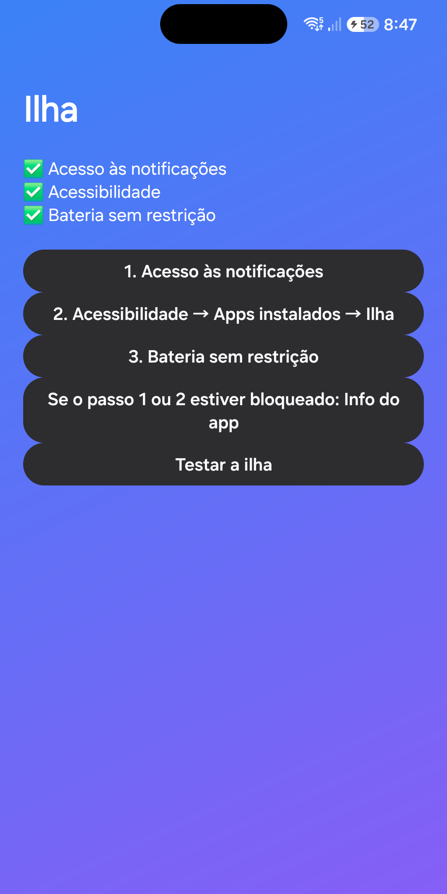
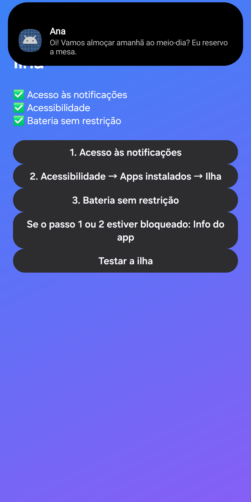
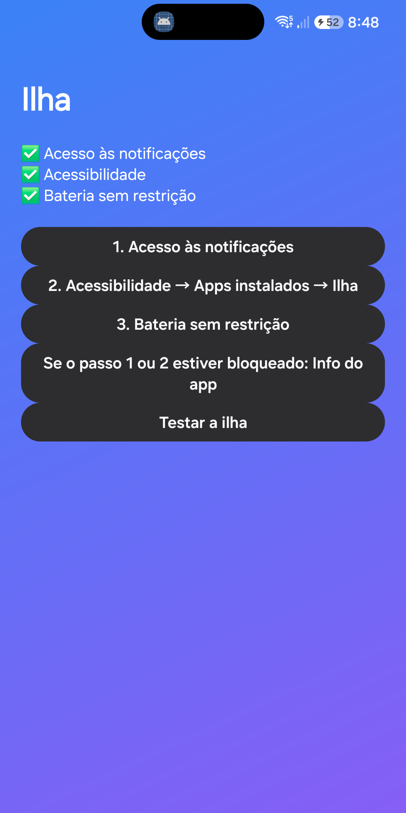

# Ilha · Ilha Dinâmica para Android

Uma ilha dinâmica ao redor da câmera frontal, no estilo do HyperOS e do iPhone. Feita e testada no **Samsung Galaxy S24 FE**; funciona em celulares com **Android 11 ou mais novo** e câmera com furo na tela.

Sem anúncios, sem compras, sem internet, sem coleta de dados e sem bibliotecas externas: só o SDK do Android.

<p>
  
  
  
</p>

## O que faz

- **Notificações na ilha:** quando chega uma mensagem, a ilha abre um cartão com o texto **abaixo da câmera** (o furo nunca tapa o texto) e depois encolhe para uma pílula com o **ícone do app ao lado da câmera**. Tocar abre a notificação; segurar mostra o texto completo.
- **Música na ilha:** enquanto toca, a **capa do álbum** fica à esquerda da câmera e **barrinhas animadas** à direita. Tocar abre os controles: anterior, tocar/pausar e próxima.
- **Sempre ativa:** a pílula fica sempre ao redor da câmera e some em paisagem (vídeos e jogos).

## Instalar

1. Baixe o **`Ilha.apk`** em [Releases](../../releases/latest) e abra no celular (permita instalar apps desta fonte, se o Android pedir).
2. Abra o app **Ilha** e siga os botões:
   1. **Acesso às notificações** → ative a Ilha.
   2. **Acessibilidade** → Apps instalados → Ilha → ative. O app usa a Acessibilidade só para desenhar a ilha por cima das outras telas; não lê o conteúdo da tela.
   3. **Bateria sem restrição** → escolha a Ilha → Não otimizar.
3. Toque em **Testar a ilha**.

**O Android bloqueou o passo 1 ou 2 ("configuração restrita")?** No app, toque em *Info do app* → menu ⋮ → **Permitir configurações restritas** e repita o passo.

### Dicas para Samsung (One UI)

- Para a ilha substituir o pop-up de notificação do sistema, desligue o pop-up em *Configurações → Notificações → Estilo de notificação pop-up*.
- Para não ser fechado: *Configurações → Bateria → Limites de uso em segundo plano → Apps nunca suspensos → Ilha*.

## Compilar

Precisa de JDK 17 e do Android SDK (plataforma 36).

```bash
./gradlew assembleDebug
```

O APK sai em `app/build/outputs/apk/debug/`. Para gerar uma versão assinada, copie `keystore.properties.exemplo` para `keystore.properties` e preencha com a sua chave (esse arquivo nunca deve ser publicado).

## Como funciona

| Arquivo | O que faz |
|---|---|
| `IslandService.kt` | Serviço de Acessibilidade. Lê a posição do furo da câmera (`DisplayCutout`) e desenha a ilha numa janela `TYPE_ACCESSIBILITY_OVERLAY`. Estados: fechada, cartão, compacta e música. O bloco `Tune` tem os ajustes de tamanho, posição e tempos. |
| `NotifListener.kt` | Leitor de notificações. Ignora silenciosas, contínuas, resumos de grupo, repetidas e as do player de música. |
| `IslandBus.kt` | Liga o leitor de notificações à ilha (mesmo processo). |
| `MainActivity.kt` | Tela de configuração: status das permissões, avisos e botão de teste. |

## Privacidade

A Ilha não guarda, não envia e não compartilha nenhum dado. Veja a [política de privacidade](loja/politica-de-privacidade.html).
